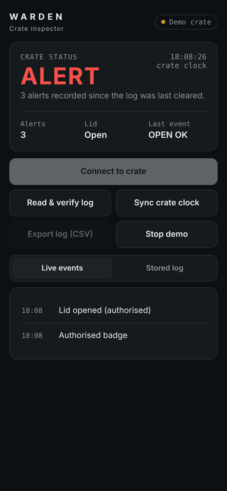
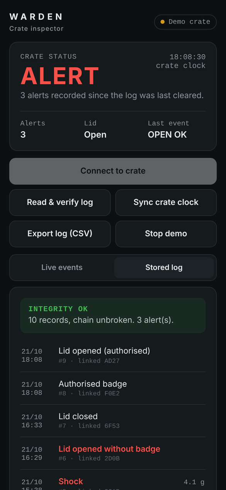
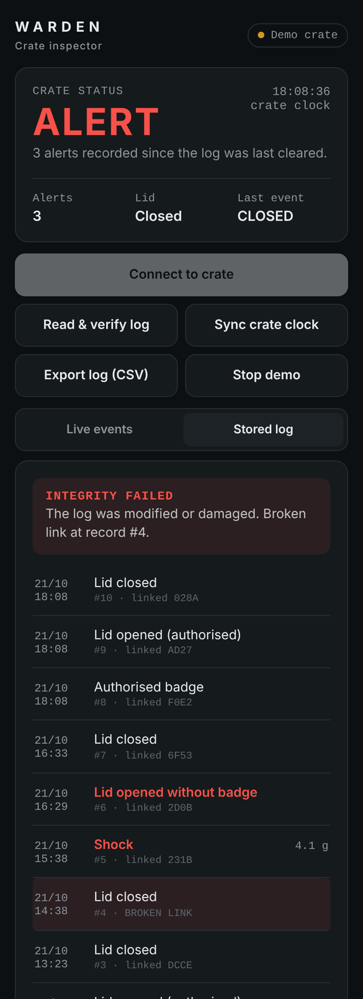
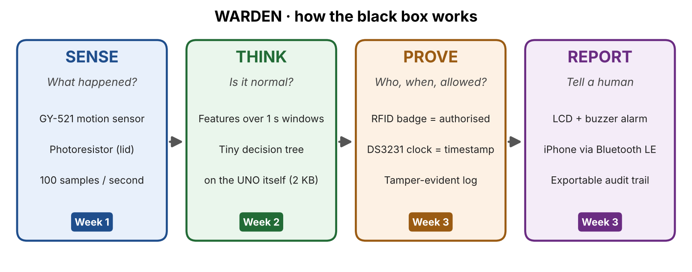

# WARDEN

**A low-cost, tamper-evident black box for military equipment crates.**

WARDEN rides inside a crate, feels every movement it goes through, knows when the lid is opened and by whom, and keeps a timestamped log that cannot be edited without it showing. An inspector reads the crate's history on its screen or from a phone, and the phone checks the log's integrity on the spot.

Built on an Arduino UNO with **2 KB of RAM**, from starter-kit parts, without soldering.

<p align="center">
  
  
  
</p>
<p align="center"><sub>Inspector app: live crate status · log downloaded and verified · a forged record detected</sub></p>

## Why

Countries supplying military equipment to partners are expected to verify where it ends up (*end-use monitoring*). In practice this relies on paperwork, serial-number checks and occasional inspections: between two inspections, nobody knows what happened to a crate. WARDEN explores a different answer: let the crate keep its own record, cheaply enough to put one in every box.

## What it does

| Layer | Function | How |
|-------|----------|-----|
| **Sense** | Motion and lid state | MPU-6050 accelerometer + gyroscope at 100 Hz, photoresistor inside the lid |
| **Think** | Recognise what is happening | Rule-based detection today (drop, shock, flip); on-device machine learning in progress |
| **Prove** | Who, when, authorised or not | RFID badges, real-time clock, hash-chained event log in non-volatile memory |
| **Report** | Tell a human | 16×2 LCD on the crate, phone app over Wi-Fi relay or Bluetooth LE |



**Events recorded:** power on, authorised badge, inspector badge, unknown badge, lid opened with or without authorisation, lid closed, drop (with impact force), shock, flipped, upright, log cleared.

**Authorisation model:** the authorised badge allows exactly one lid opening within 30 seconds. Any other opening is logged as an alert. The inspector badge scrolls the most recent events on the crate's screen.

## Tamper-evident log

Each record (time, event, value) is stored with a 16-bit *chain* value computed over the previous chain value and the record itself. Editing, deleting or reordering any record breaks every link after it, the way a page torn out of a numbered, glued logbook leaves a gap. The log lives in the 4 KB AT24C32 memory of the clock module and survives power loss; a reboot is itself recorded.

The chain is verified independently of the crate, by `tools/verify_log.py` on a laptop or inside the phone app.

**Known limitation.** CRC-16 detects accidental damage and naive edits, not an attacker who knows the algorithm and can recompute the chain. A production design would use a keyed MAC (e.g. HMAC-SHA256) with the key held in a secure element (e.g. ATECC608), so that only the crate can produce valid records. This is the first item on the security roadmap.

## Hardware

Arduino UNO R3, prototype shield with a 170-point mini breadboard, GY-521 (MPU-6050), photoresistor, RC522 RFID reader, DS3231 real-time clock with AT24C32 memory, LCD 1602. Bill of materials, pin map and wiring: **[docs/hardware.md](docs/hardware.md)**.

## Repository layout

```
firmware/warden/            main firmware (v0.3)
firmware/diagnostics/       one-purpose test sketches: I2C scan, motion stream, LCD, RFID
app/index.html              phone inspector app (single file, no dependencies)
tools/record.py             record labelled motion sessions for the training dataset
tools/plot.py               plot a recorded session
tools/verify_log.py         download the crate's log over USB and verify its integrity
tools/bridge.py             relay between the crate (USB) and the phone app (Wi-Fi)
docs/hardware.md            bill of materials, pin map, wiring
docs/engineering-log.md     dated build log: measurements, decisions, bugs and fixes
data/raw/                   training dataset (labelled CSV sessions)
```

## Getting started

**Firmware.** Open `firmware/warden/warden.ino` in the Arduino IDE, install the *MFRC522* library (Library Manager, by GithubCommunity), select *Arduino Uno* and upload. On first boot the clock is set to the compile time. Over the serial port (115200 baud) the crate accepts `dump`, `clear` and `time YYYY-MM-DD HH:MM:SS`.

**Laptop tools.** Python 3.9+:

```bash
python3 -m venv .venv && source .venv/bin/activate
pip install -r requirements.txt
python tools/verify_log.py                      # read and verify the crate's log
python tools/record.py --label drop --seconds 20
python tools/plot.py --latest
```

**Phone app.** Two ways to reach the crate, same app and protocol:

- *Via a Mac (works today):* run `python tools/bridge.py` with the crate on USB, then open the printed address in Safari on an iPhone connected to the same Wi-Fi.
- *Bluetooth LE (HM-10 module, in progress):* open the [hosted app](https://matt777777777.github.io/Warden/app/) in the Bluefy browser on iPhone (Safari has no Web Bluetooth).

A demo mode simulates a crate, including a forged record, without any hardware.

## Serial protocol

| Direction | Line | Meaning |
|-----------|------|---------|
| crate → host | `t_ms,ax_g,ay_g,az_g,gx_dps,gy_dps,gz_dps,light` | 100 Hz sensor stream |
| crate → host | `#S,<alerts>,<lid>,<auth s>,<unix>` | status, every 2 s |
| crate → host | `#E <date> <time> <EVENT> [<g>] [ALERT]` | live event |
| crate → host | `#L,<seq>,<unix>,<datetime>,<event>,<value>,<chain>` | log dump, ends with `#L,END,<count>,<chain>` |
| host → crate | `dump` · `time YYYY-MM-DD HH:MM:SS` · `clear` | commands (`clear` is not relayed to the phone) |

## Roadmap

- [x] Motion and light sensing, 100 Hz streaming and labelled recording tools
- [x] Compact solder-free build: clock, RFID, LCD, shared I2C bus
- [x] Rule-based detection, badge authorisation, hash-chained log, integrity verifier
- [x] Phone inspector app with Wi-Fi relay and demo mode
- [ ] Final enclosure (opaque plastic crate) and labelled dataset collection
- [ ] On-device classifier (features computed on the fly, small decision tree exported to C), benchmarked against the rules
- [ ] Bluetooth LE link (HM-10) and battery operation
- [ ] Keyed MAC instead of CRC for the log chain

## Scope

WARDEN is a defensive, educational prototype focused on accountability and arms-control verification. It is not a certified security product.

## License

MIT. See [LICENSE](LICENSE).
