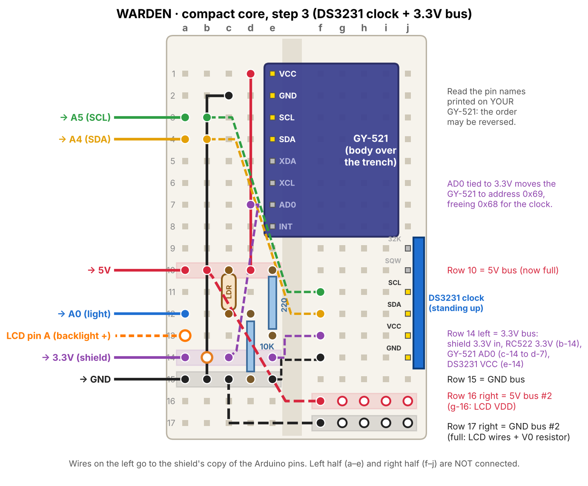

# WARDEN hardware

Everything runs on an Arduino UNO R3 from a standard starter kit, built without soldering: a prototyping shield stacked on the UNO, a 170-point mini breadboard stuck on the shield, and male-female jumpers to the parts mounted on the lid.

## Bill of materials

| Part | Role | Notes |
|------|------|-------|
| Arduino UNO R3 (Elegoo) | Main controller | ATmega328P, 32 KB flash, 2 KB RAM |
| Prototype shield V5 + 170-point mini breadboard | Compact, rigid core | Sensor and breadboard move as one block with the UNO |
| GY-521 (MPU-6050) | Accelerometer + gyroscope | ±8 g, ±500 °/s, 100 Hz, I2C 0x69 |
| Photoresistor + 10 kΩ | Lid sensor (light inside the crate) | Voltage divider on A0 |
| RC522 RFID reader + 2 tags | Authorisation and inspection badges | Clone chip (version 0x88), 3.3 V |
| DS3231 module (ZS-042) | Real-time clock | I2C 0x68, 3.3 V only (see warning) |
| AT24C32 (on the ZS-042) | 4 KB non-volatile event log | I2C 0x57 |
| LCD 1602 | On-crate status display | 4-bit parallel mode |
| HM-10 (planned) | Bluetooth LE link to the phone app | Not yet fitted |
| Opaque plastic crate (planned) | Enclosure | Not metal: it would block Bluetooth and RFID |

## UNO pin map

| UNO pin | Connected to |
|---------|--------------|
| A0 | Photoresistor divider (lid) |
| A1 | LCD D7 |
| A2, A3 | Spare |
| A4 (SDA), A5 (SCL) | I2C bus: GY-521 (0x69), DS3231 (0x68), AT24C32 (0x57) |
| D0, D1 | USB serial to the laptop (reserved) |
| D2, D3 | HM-10 Bluetooth, software serial (planned) |
| D4 | LCD RS |
| D5 | LCD E |
| D6, D7, D8 | LCD D4, D5, D6 |
| D9 | RC522 RST |
| D10 | RC522 SDA (SPI chip select) |
| D11, D12, D13 | RC522 MOSI, MISO, SCK (SPI) |

The bus check sketch `firmware/diagnostics/i2c_scan` must report exactly 0x57, 0x68 and 0x69.

## Mini breadboard power buses

The mini breadboard has no power rails, so whole rows are used as buses. Rows are numbered 1 to 17 from the end opposite the USB connector; columns a to e and f to j are the two halves (not connected to each other).

| Bus | Holes | Fed from |
|-----|-------|----------|
| 5 V | row 10, a-e | shield 5V → a-10 |
| GND | row 15, a-e | shield GND → a-15 |
| 3.3 V | row 14, a-e | shield 3.3V → a-14 |
| 5 V #2 | row 16, f-j | b-10 → f-16 |
| GND #2 | row 17, f-j | c-15 → f-17 |

## Modules on the mini breadboard

**GY-521** pins in column e, rows 1-8, body lying over the trench. VCC → 5V bus, GND → GND bus, SCL → shared SCL row → A5, SDA → shared SDA row → A4. **AD0 is tied to the 3.3V bus**, which moves the sensor from I2C address 0x68 to 0x69: the DS3231 also uses 0x68, and two devices cannot share an address.

**Photoresistor** c-10 (5V bus) to c-12, mounted upright, legs not touching anything. **10 kΩ** from d-12 to d-15 (GND bus). A0 from a-12. Readings: ~740 ambient, ~40 in the dark (closed crate). Firmware thresholds: open above 400, closed below 300.

**DS3231** standing in column j, rows 9-14 (mounted the opposite way round to the drawing; always follow the printed pin names): GND j-9 → e-15, VCC j-10 → e-14 (3.3V bus), SDA j-11 → SDA row, SCL j-12 → SCL row. SQW and 32K unused.

> **Warning.** The ZS-042 module trickle-charges its coin cell. Fitted with a non-rechargeable CR2032, it must never be powered from 5 V. At 3.3 V no charge current flows.

## Parts on the lid (male-female jumpers)

### LCD 1602

| LCD pin | Goes to |
|---------|---------|
| VSS | GND #2 (g-17) |
| VDD | 5V #2 (g-16) |
| V0 (contrast) | g-15, then 1 kΩ from h-15 to GND #2 (h-17) |
| RS | D4 |
| RW | GND #2 (i-17) |
| E | D5 |
| D0-D3 | not connected |
| D4, D5, D6, D7 | D6, D7, D8, A1 |
| A (backlight +) | a-13, then 220 Ω from e-13 to the 5V bus (e-10) |
| K (backlight -) | GND #2 (j-17) |

### RC522 RFID reader

| RC522 pin | Goes to |
|-----------|---------|
| 3.3V | 3.3V bus (b-14), never 5 V |
| GND | shield GND |
| RST | D9 |
| SDA | D10 |
| MOSI | D11 |
| MISO | D12 |
| SCK | D13 |
| IRQ | not connected |

## Build sequence

| Step | Layout |
|------|--------|
| 1. Motion sensor, light sensor, 5V and GND buses | [build-step-1.png](media/build-step-1.png) |
| 2. Second buses for the lid, backlight resistor | [build-step-2.png](media/build-step-2.png) |
| 3. 3.3V bus, DS3231 clock, GY-521 address change | [build-step-3.png](media/build-step-3.png) |
