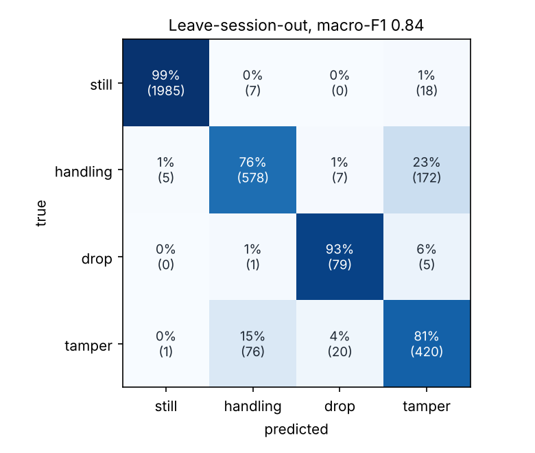

# WARDEN motion model: training report

Generated by `tools/train.py`.

## Data

90 labelled sessions of 20 s recorded in the final crate, 3510 windows of 1 s (one every 0.5 s), 3374 used for training after label cleaning.

| Class | Training windows |
|---|---|
| still | 2010 |
| handling | 762 |
| drop | 85 |
| tamper | 517 |

## Model

Random forest, 10 trees, max depth 6, 536 nodes, 17 features computed on the fly (`firmware/warden/features.c`), hard majority vote. Exported to `firmware/warden/model.h` (about 4.7 KB of flash, no RAM besides the 17 feature values).

## Window-level accuracy (5-fold cross-validation grouped by session)

Accuracy 90.8%, macro-F1 0.843. Windows of a given session are never split between training and test.

## Alerts: machine learning vs the rule-based firmware

Share of sessions raising at least one alert (rules replayed on the same raw data; ML predictions are cross-validated, i.e. on sessions the model never saw).

| Session type | Rule DROP | Rule SHOCK | ML TAMPER | ML TAMPER + lid sensor |
|---|---|---|---|---|
| still | 0 % | 0 % | 0 % | 0 % |
| open | 0 % | 0 % | 20 % | 0 % |
| carry | 7 % | 47 % | 13 % | 13 % |
| flip | 0 % | 20 % | 0 % | 0 % |
| drop | 100 % | 0 % | 0 % | 0 % |
| tamper | 0 % | 47 % | 100 % | 100 % |

ML tamper alert = at least 3 of the last 4 windows classified *tamper* by at least 80% of the trees. In the last column, windows where the light sensor sees the lid open are ignored: openings are judged by the light + badge rule, and a normal opening gesture resembles forcing. Drops stay with the physical rule (free fall then impact), which is already near perfect; flips stay with the orientation rule. The model takes over what the rules cannot do: telling forced entry from normal handling.

## Most useful features

| Feature | Importance |
|---|---|
| acc_min | 0.201 |
| gyro_max | 0.178 |
| gyro_mean | 0.136 |
| az_std | 0.077 |
| freefall_frac | 0.072 |
| ay_mean | 0.053 |
| jerk | 0.051 |
| acc_std | 0.050 |

## Known limits

No road-transport data was collected: in a vehicle the model will see vibrations it has never learnt. One crate, one operator and one day of recordings: performance on other crates is not established.
